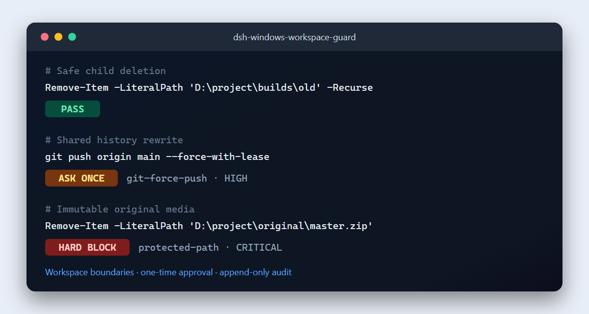

# Windows Workspace Guard for DeepSeek Harness

New in v2.0.0: native DSH 0.2.x settings with live policy updates and validated mode choices.

> Compatibility: v2 requires DSH 0.2.1-rc.3 or later within 0.2.x. DSH 0.1.2-rc.1 users should retain v1.2.0. Native schema-generated settings replace the legacy custom client card; profile configuration updates apply immediately.

**Understand what your Windows agent is about to change—and why a call was blocked.**

| Your problem | Ask the agent |
|---|---|
| A command looks risky | “Check this command without executing it.” |
| Protection seems incomplete after an upgrade | “Run windows_workspace_guard_doctor and explain uncovered tools.” |
| Too many blocks, no clear explanation | “Run windows_workspace_guard_audit_summary and show the most frequent rule IDs.” |

### New in v1.2.0: make audit logs useful

The new `windows_workspace_guard_audit_summary` tool reads the configured audit log and returns decision totals and frequent rule IDs. It excludes commands, working directories, and target paths. Malformed rows and the 100,000-record limit are reported explicitly so partial evidence is visible.

Set `auditPath` to a project-owned JSONL path in the plugin settings to collect future decisions. Logging is opt-in; the tool cannot reconstruct old activity. You can also run `node audit-summary.js D:\project\logs\guard.jsonl` from the package directory without a model or API key.

Use the summary to identify a rule, then inspect that specific case with the dry-run tool before changing policy.


### Investigate a time window or decision

```powershell
node audit-summary.js D:\project\logs\guard.jsonl --since 2026-10-18T00:00:00Z --until 2026-10-18T23:59:59Z --decision blocked-hard
```

The agent tool accepts the same `since`, `until`, and `decision` parameters. Timestamps require an explicit timezone; both bounds are inclusive. `records` counts valid scanned rows; `matched` counts selected rows. Time filtering excludes missing or invalid timestamps and counts them in `invalidTimestamps`. The 32 MiB / 100,000-record bounds still apply to scanned input, including excluded rows. Calls without filters retain the original aggregate behavior.

[中文](README.zh.md) | English

[](https://dshbase.com/plugins/dsh-windows-workspace-guard/) [](https://github.com/julescules/dsh-windows-workspace-guard/actions/workflows/ci.yml)

> [!IMPORTANT]
> Unofficial community plugin. Independently developed and maintained; not reviewed or endorsed by DeepSeek.

Stop a Windows agent before it deletes originals, escapes the workspace, destroys Git recovery paths, reads credentials, or changes system state. PowerShell and both official filesystem suites receive a clear **PASS**, **ASK**, or **HARD BLOCK** before dispatch.



## Start in 30 seconds

```powershell
dsh plugin --profile web add github:julescules/dsh-windows-workspace-guard#v2.0.0
dsh --profile web --dump-config
dsh --profile web
```

Restart DSH, then ask:

```text
Run windows_workspace_guard_doctor, then use windows_workspace_guard_check
to inspect this command without executing it:
Get-Content -LiteralPath $env:DSH_HOME\.credentials.yaml
```

## Policy coverage

### Verified multi-tool boundary

The default protected set follows the official rc.1 Windows/file surface: `pwsh`, `read`, extensionless-capable `read_image`, `write`, `edit`, `glob`, `grep`, and Minimal's `str_replace_editor`. Each adapter reads only the official path and operation fields, omits file content, search text, and replacement strings from policy previews, and applies the same workspace, immutable-path, existing-link, and sensitive-path rules.

Configured tools without a verified argument adapter fail closed. Doctor reports every configured tool as `covered` or `unsupported`; the plugin never treats an unknown schema as PowerShell and calls it protected.

Profile configuration remains authoritative. Copy any legacy settings-section overrides into the profile before upgrading. If `toolNames` is a shorter list, add `read_image`, `glob`, and `grep` in the native form; Doctor shows the effective coverage.

Official `grep` searches hidden and ignored files. With `guardSensitiveData` enabled, v1.2.0 requires a narrow `include` glob such as `*.js` or `*.ks`; an unbounded search fails closed before a hidden `.env` can be returned. Explicit credential-like paths and glob patterns are blocked too.

### Monotonic hard blocks

Workspace escapes and unverifiable mutation paths are hard blocks. `allowExact` remains available for explicit review-level commands, but it cannot authorize a write outside the configured workspace or bypass any non-overridable policy.

Static non-overridable rules are also registered through the official synchronous `ctx.tools.guard()` seam. They remain denials even if another reorderable `tools/pre-execute` listener short-circuits its waterfall. Older Harness builds without that API keep the pre-execute fallback.

Live junction/symlink inspection remains asynchronous in `tools/pre-execute`; it cannot be moved into a synchronous guard and is reported honestly as a separate layer.

### Credential and secret boundary

With `guardSensitiveData: true` (default), guarded `pwsh`, `read`, and editor calls block explicit reads or copies of:

- `$DSH_HOME\.credentials.yaml` and `.env` files;
- user SSH, AWS, Azure, Git, npm, GitHub CLI, and NuGet credential locations;
- configured `sensitivePaths`;
- sensitive environment variables and full `Env:` enumeration;
- same-command outbound-network use combined with an explicit sensitive source.

This is a conservative tool boundary, not a general DLP system. It does not inspect arbitrary native-process memory, already-running processes, or tools outside `toolNames`.

### Read-only Windows doctor

`windows_workspace_guard_doctor` reports facts without changing ACLs or configuration:

- `ctx.tools.guard()` availability;
- configured-tool coverage and adapter type;
- DSH home and configured workspace/protected path state;
- existing link metadata for configured roots;
- audit-path writability and bounded duplicate-runtime checks;
- credential-file ACL metadata on Windows, without opening credential contents.

## Decisions

| Result | Meaning |
|---|---|
| PASS | No matched risk under the active policy. |
| ASK | A reviewable operation needs one host approval in `mode: ask`. |
| HARD BLOCK | Disk/system mutation, policy bypass, immutable path, link traversal, or sensitive-data access cannot be approved away. |

Use `windows_workspace_guard_check` for a dry run. Select `pwsh` with `command`; select `read`, `write`, or `edit` with `path`; or select `str_replace_editor` with an operation plus absolute `path`. It returns machine-readable findings and never executes the call.

## Main settings

The native DSH plugin settings form updates these values live:

```yaml
enabled: true
mode: block               # block | ask | report
toolNames: [pwsh, read, read_image, write, edit, glob, grep, str_replace_editor]
workspaceRoots: []        # empty = current session cwd
protectedPaths: []
guardExistingLinks: true
guardSensitiveData: true
sensitivePaths: []
auditPath: ''             # optional append-only JSONL
auditIncludeCommand: false
auditFailClosed: false
```

With an audit path, dispatch writes occur after host approval and monotonic guards. Denied calls are observed after their final result. Commands are hashed and redacted by default.

## DSH integration

The package stays outside Harness core and uses the official `dsh.bundle.patch`, `tools/pre-execute`, `ctx.tools.guard()`, `tools/execute`, `tools/result`, settings, and typed-tool seams.

## Upgrade, disable, uninstall

```powershell
dsh plugin --profile web add github:julescules/dsh-windows-workspace-guard#v2.0.0
dsh plugin --profile web list
dsh plugin --help
```

Use the disable/remove command shown by `dsh plugin --help` for your Harness build, then restart DSH. Profile command names are still changing during developer preview.

## Troubleshooting and data

- Missing settings card: run `dsh --profile web --dump-config`, confirm `windows-workspace-guard`, then restart Web.
- False positive: run the dry-run tool and report finding IDs plus a redacted command/path.
- The plugin makes no network requests. Doctor reads filesystem/ACL metadata only and never credential values.
- No audit file is created unless `auditPath` is configured.
- Keep `workspaceRoots` and `sensitivePaths` absolute and narrow.

## Verify

```powershell
npm run check
npm pack --dry-run
node scripts/build-release-metadata.mjs .\dsh-windows-workspace-guard-2.0.0.tgz .\builds\v2.0.0
.\scripts\verify-release.ps1 -PackagePath .\dsh-windows-workspace-guard-2.0.0.tgz -ChecksumsPath .\builds\v2.0.0\SHA256SUMS
```

Each release ships a SHA-256 checksum and CycloneDX SBOM. The verifier reads files literally and makes no network request.

## Limits

- Static policy is not an operating-system sandbox.
- A filesystem TOCTOU window remains between link inspection and execution.
- Tools outside `toolNames` are not covered; configured names with unknown argument schemas fail closed and appear as Doctor warnings.
- ACL warnings are review evidence, not automatic permission repair.

For missed cases, reply in the [official community plugin thread](https://github.com/deepseek-ai/deepseek-harness/discussions/2429) with Windows, PowerShell and DSH versions, a redacted command, expected PASS/ASK/BLOCK, and redacted doctor output.

See [CONTRIBUTING.md](CONTRIBUTING.md) and [SECURITY.md](SECURITY.md).

## License

[MIT](LICENSE)

Compatibility: v2 requires DSH 0.2.1-rc.3 or later within 0.2.x. DSH 0.1.2-rc.1 users should retain v1.2.0. Native schema-generated settings replace the legacy custom client card; profile configuration updates apply immediately.

Host contract regression: install the pinned dependencies shown in `.github/workflows/ci.yml`, then run `npm run test:host`. Verified against actual rc.3 Loader/Settings/Tools with an in-memory profile editor: live policy updates, unchanged plugin fiber, stale revision and invalid-mode rejection. Browser rendering and model execution are not covered. Legacy settings-section overrides must be copied into profile configuration when upgrading; v2 does not import old settings files.
